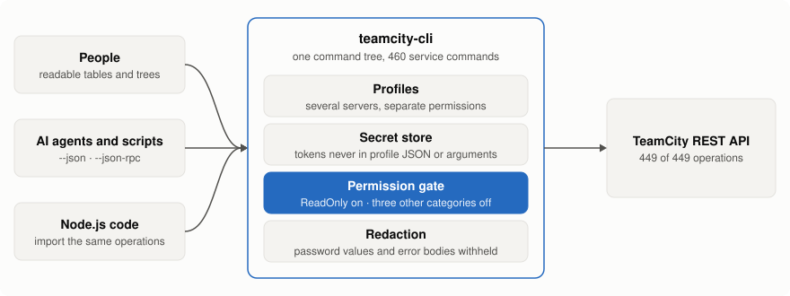
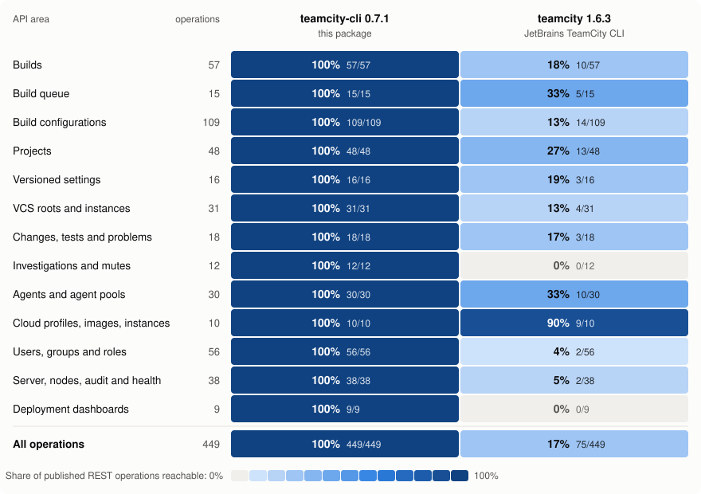

# teamcity-cli

**The whole TeamCity REST API as one command-line tool that is safe to hand to an AI agent.**

```sh
npm install --global @eyeauras/teamcity-cli
teamcity-cli profile configure        # server URL + access token, asked once
teamcity-cli builds list --job Demo_Tests --branch main --limit 20
```

## Why

| | |
|---|---|
| **Complete** | All 449 operations in the REST description TeamCity 2026.1 publishes are reachable: builds, queue, build configurations, projects, VCS, agents, cloud, users, server administration. |
| **Read-only by default** | A fresh profile can only read. Writes need `permissions grant Update` for that profile; account and server administration need `Admin`, token and secret workflows need `Credentials`, each granted separately. |
| **Made for build triage** | `builds diagnose` answers "why did it fail" in one call: up to 10 problems and 20 failed tests. `jobs run --wait` and `builds wait` exit 0 on success, 1 on failure, 124 on timeout, 130 on Ctrl+C. |
| **Cheap for agents** | `--json` on every command, paged lists (`--limit`, `--start`) that return `hasMore` and `nextStart`, stable error codes, and a persistent `--json-rpc` session without restarting Node. |
| **Profile credentials** | Profile tokens live in the platform secret store, never in profile JSON. Writes forward caller input; secret aliases are optional. Password/secure parameters come back as `redacted: true`, and errors carry the HTTP status, never the response body. |
| **Predictable** | No write is retried or replayed. When the answer to a queue request is lost, `jobs run` reports `run.unknownOutcome` and the command to check with, instead of posting again. |

<picture>
  <source media="(prefers-color-scheme: dark)" srcset="docs/images/how-it-works-dark.svg">
  
</picture>

Requests send what the caller supplies. TeamCity validates service values and applies omitted-field
defaults. Native JSON DTOs work alongside compact options; permission gates, confirmations and local
file/credential safety remain enforced. See the [request contract](docs/reference.md).

## Coverage

Every documented query parameter of those operations is caller-controlled; see the [current REST coverage](docs/rest-api-coverage/current/README.md).

Share of the 449 published REST operations each tool can call through its own commands, by API area.
Operation coverage remains 449/449; 0.9.0 improves the returned configuration data, including full
scripts and plain settings that 0.8.0 hid. The matrix does not measure response-field completeness.

<picture>
  <source media="(prefers-color-scheme: dark)" srcset="docs/images/coverage-matrix-dark.svg">
  
</picture>

The JetBrains CLI also has a raw `teamcity api` request command and features outside this API
(build logs, pipelines, agent terminals) that this tool does not have. `bbox` and `tctest` are
small single-purpose tools: build triggering and clean-up, and test runs for pull requests.
Numbers, method and caveats: [coverage comparison](docs/coverage-comparison.md).

## Use it

```sh
# read: why did build 101 fail, as JSON
teamcity-cli builds diagnose 101 --json

# write: allow it for this profile once, then queue a build and wait for the result
teamcity-cli permissions grant Update --profile uat
teamcity-cli jobs run Demo_Tests --profile uat --branch main --wait --timeout 10m

# discover: every level has help
teamcity-cli --help
teamcity-cli builds --help
```

Read commands return the configuration values TeamCity makes available to your token, including
full scripts, Docker options, requirement operands and VCS connection settings. Only password-type
parameters, `secure:` properties and values withheld by TeamCity stay hidden.
Plain values such as `*` (a cron wildcard) and `*****` remain readable; their spelling does not
determine secrecy. Writes forward caller-supplied names and values for TeamCity to validate, including
password-typed parameters and credential-like values. Read schedule properties with `jobs triggers show <job-id> <trigger-id>`.
Use `jobs configuration show <job-id> --json` for build settings and content,
`projects templates show <template-id> --json` for a template, and
`agents parameters list <agent-id> --json` for system, environment and configuration parameters.
Treat real output as private configuration when sharing it.

Needs Node.js 22+. Your server's version and your account's rights still decide what a call is
allowed to do; the local permission gate does not replace TeamCity's own authorization.

## More

- [Command reference](docs/reference.md): every command family, paging, running and waiting, files, sign-in, error codes.
- [Coverage comparison](docs/coverage-comparison.md): the numbers behind the matrix and how they were measured.
- [Design](docs/DESIGN.md) of the shared runtime and the [release guide](docs/release.md).
- Built on AI CLI Factory (`@eyeauras/cli-factory`). [MIT licensed](LICENSE).
